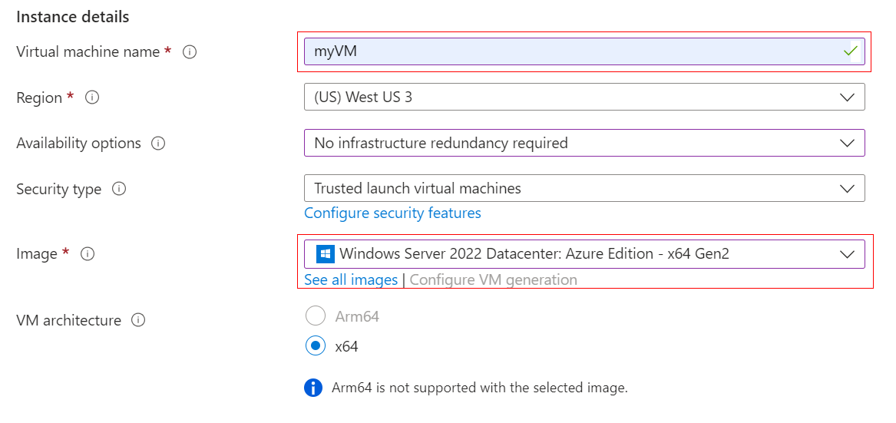
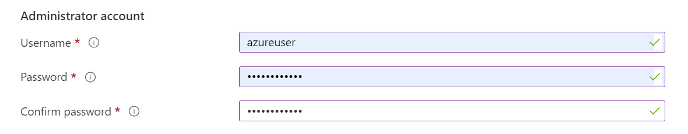
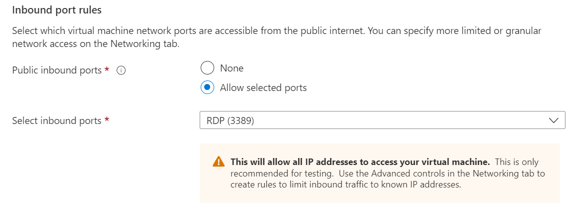
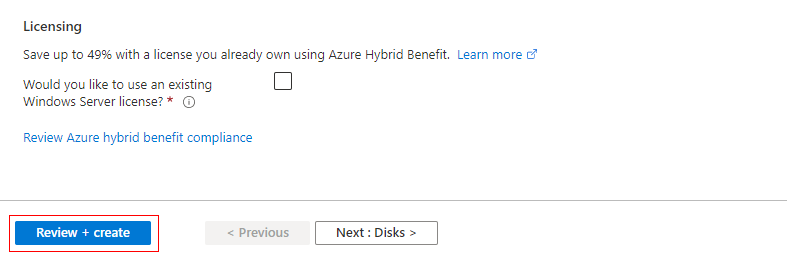
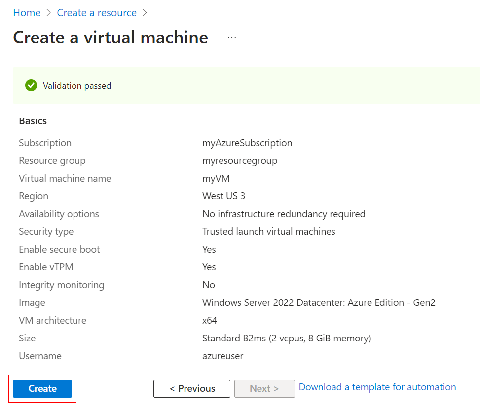
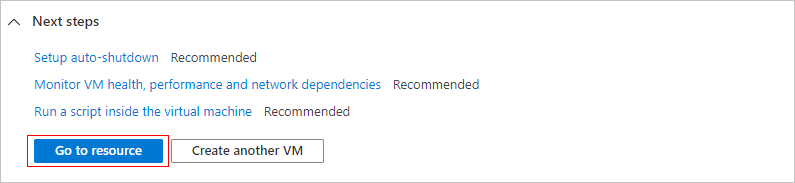

# Lab Guide: Create a Virtual Machine in the Azure Portal

In this lab you create a Windows virtual machine (VM) with the Azure portal. Tick each box as you finish a step. Copy the values from the grey boxes instead of typing them.

> [!NOTE]
> This is an example lab. The screenshots come from Microsoft Learn and may show a different region or resource group name than your screen. Follow the values in this guide, not the screenshots.

**Time:** about 15 minutes. **Cost:** the VM is billed while it runs, so finish the clean-up step at the end.

## Before you start

- [ ] You have your lab username and Temporary Access Pass (TAP) from the lab handout.
- [ ] You are using the Microsoft Edge browser on your lab desktop.

## Step 1: Sign in to the Azure portal

- [ ] Open a new browser tab and go to the Azure portal.

```text
https://portal.azure.com
```

- [ ] Enter your lab username (for example `LabUser001@msftlabs.org`) and select **Next**.
- [ ] Enter your TAP when asked, then select **Sign in**.

<!-- TODO: add a screenshot of the sign-in page. -->

## Step 2: Start the Create a virtual machine wizard

- [ ] Type `virtual machines` in the search box at the top of the portal.
- [ ] Under **Services**, select **Virtual machines**.
- [ ] Select **Create**, then select **Virtual machine**. The **Create a virtual machine** page opens.

<!-- TODO: add a screenshot of the Virtual machines page with the Create menu open. -->

## Step 3: Fill in the Basics tab

- [ ] Under **Project details**, leave **Subscription** as it is.
- [ ] For **Resource group**, select the existing group named after your lab user (for example `LAB-LabUser001`). Do not create a new one.
- [ ] Under **Instance details**, enter the values below.

| Field | Value |
| --- | --- |
| Virtual machine name | `myVM` |
| Region | `(US) Central US` |
| Availability options | No infrastructure redundancy required |
| Security type | Trusted launch virtual machines |
| Image | `Windows Server 2022 Datacenter: Azure Edition - x64 Gen2` |
| VM architecture | x64 |
| Size | `Standard_B2ms` |

Copy the VM name:

```text
myVM
```

Copy the image name (you can also type part of it into the **Image** box and pick it from the list):

```text
Windows Server 2022 Datacenter: Azure Edition - x64 Gen2
```



## Step 4: Create the administrator account

- [ ] Under **Administrator account**, enter the username below.

```text
azureuser
```

- [ ] Enter a password that is at least 12 characters long and uses upper case, lower case, a number and a symbol. Write it down, you need it to sign in to the VM.
- [ ] Enter the same password in **Confirm password**.



## Step 5: Choose the inbound port

- [ ] Under **Inbound port rules**, set **Public inbound ports** to **Allow selected ports**.
- [ ] In **Select inbound ports**, choose **RDP (3389)**.

> [!WARNING]
> This opens the port to every IP address. It is fine for this short lab, but do not do this for a real workload.



## Step 6: Review and create

- [ ] Leave every other setting at its default.
- [ ] Select **Review + create** at the bottom of the page.



- [ ] Wait for the **Validation passed** message and check that the name, region, image and size match this guide.
- [ ] Select **Create**.



## Step 7: Open the new VM

- [ ] Wait for the message **Your deployment is complete** (about 2 to 5 minutes).
- [ ] Select **Go to resource**.



- [ ] On the VM **Overview** page, confirm that **Status** is **Running**.

<!-- TODO: add a screenshot of the VM Overview page showing the Running status. -->

## Step 8: Clean up

> [!IMPORTANT]
> Delete only the VM and the resources created with it. Do not delete your resource group, it belongs to your lab account.

- [ ] Open your resource group (for example `LAB-LabUser001`) from the VM's **Overview** page.
- [ ] Tick the box next to **Name** to select every resource in the list.
- [ ] Select **Delete** at the top of the page.
- [ ] Type `delete` to confirm, then select **Delete**.

<!-- TODO: add a screenshot of the resource group delete confirmation. -->

You are done. Raise your hand and tell the instructor.

## Attribution

The screenshots in this guide are copied unchanged (renamed only) from the Microsoft Learn article [Quickstart: Create a Windows virtual machine in the Azure portal](https://learn.microsoft.com/azure/virtual-machines/windows/quick-create-portal). The article source is in the [MicrosoftDocs/azure-compute-docs](https://github.com/MicrosoftDocs/azure-compute-docs) repository, which is licensed under the [Creative Commons Attribution 4.0 International license](https://creativecommons.org/licenses/by/4.0/). Microsoft and Azure trademarks are not covered by that license.
